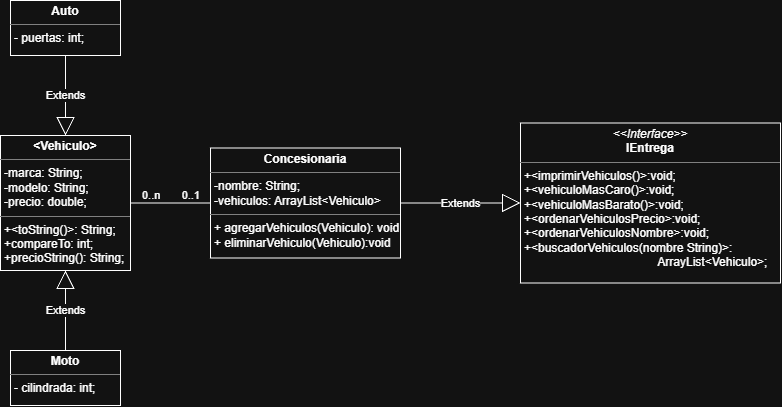

# TP2-POO
Repositorio del Trabajo Práctico N°2 de Programación Orientada a Objetos.
**Profesor: Francisco Acuña**
## UML

## Resumen estructura
Las clases Moto y Auto son hijas de la clase abstracta Vehiculo, esta contiene la definición del compareTo y la función abstracta toString, tambien la función precioString para facilitar el pasaje de double a String.

La clase Concesionaria tiene una ArrayList de vehiculos como atributo, implementa la interface IEntrega que define las funciones que se usarán para la entrega.

